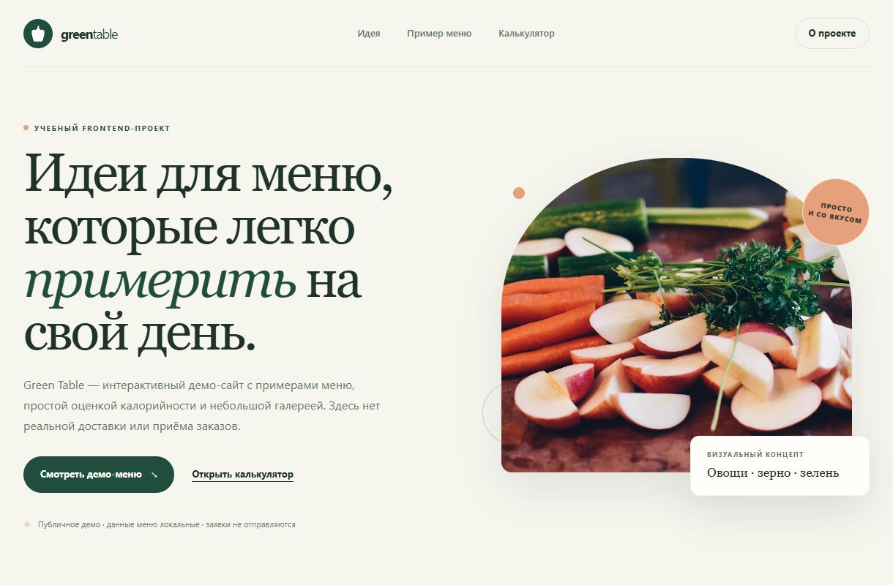
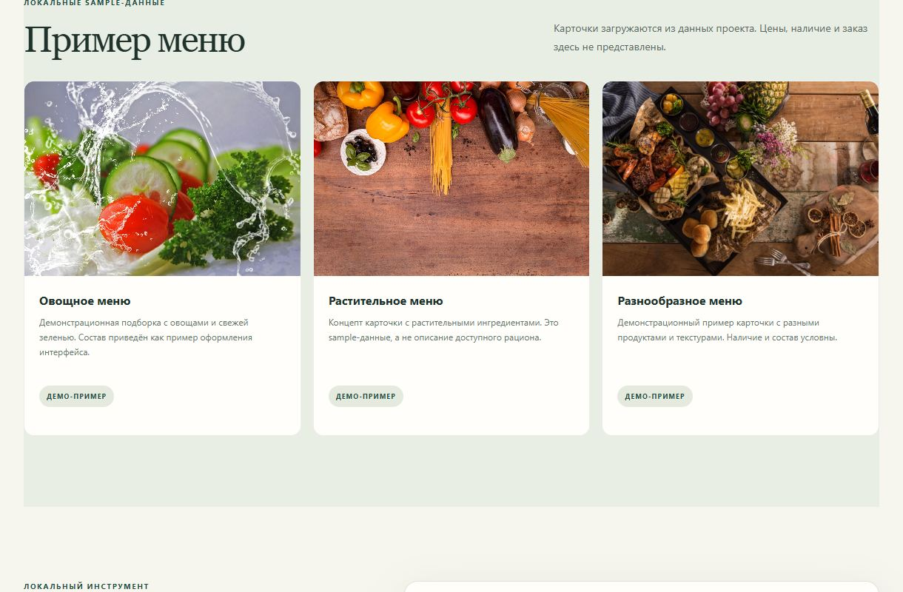
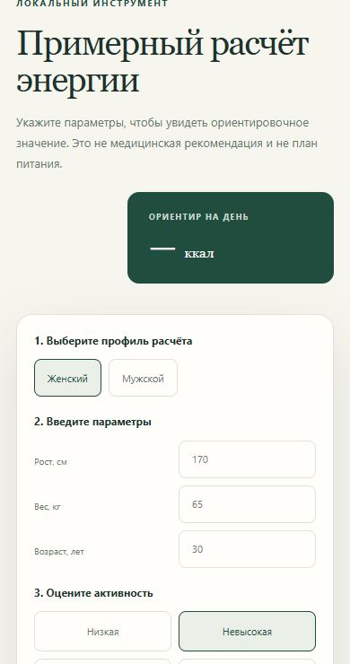

<div align="center">

# 🥗 Green Table

**Интерактивный планировщик меню. Сравните четыре подхода к питанию, посмотрите примеры блюд и рассчитайте ориентир суточной энергии.**

  

[Открыть Green Table](https://goldlexx.github.io/food/) · [Интерфейс](#интерфейс) · [Локальный запуск](#локальный-запуск)

</div>



## Интерфейс

1. **Выберите направление.** Вкладки «Овощное», «Разнообразное», «Растительное» и «Сбалансированное» открывают описание подхода. Переключать их можно мышью или клавишами ← и →.
2. **Рассмотрите меню.** Каждая карточка собирается из названия, описания и изображения в [db.json](db.json). Пометка «Демо-пример» объясняет происхождение блюд. Цены и доступность для заказа сайт не рассчитывает.
3. **Получите ориентир.** Укажите рост, массу, возраст, пол и уровень активности. Калькулятор пересчитывает значение при вводе, а до заполнения обязательных полей показывает прочерк. Пол и коэффициент активности сохраняются в браузере.
4. **Пролистайте галерею и попробуйте форму.** На опубликованной странице форму можно открыть и заполнить. Вместо отправки заявки появится сообщение о демонстрационном режиме.



<details>
<summary>Калькулятор на экране телефона</summary>



</details>

## Как устроен проект

| Технология | Что делает в проекте |
| --- | --- |
| HTML и CSS | Секции лендинга, адаптивные карточки и диалог формы |
| JavaScript | Вкладки с клавиатурной навигацией, калькулятор, галерея и состояния формы |
| Webpack и Babel | Сборка модулей из точки входа в браузерный скрипт |
| JSON Server | Необязательный локальный API для проверки отправки тестовой формы |

[Точка входа](js/script.js) связывает [модули интерфейса](js/modules/). [Слой запросов](js/services/services.js) читает примеры меню из статического JSON на Pages. Локально он сначала обращается к JSON Server и при недоступности меню использует тот же файл.

## Локальный запуск

Потребуются Node.js 18.12 или новее и npm. Из корня репозитория выполните

```sh
npm ci
npm run build
python -m http.server 8000
```

Откройте `http://localhost:8000/`. Webpack записывает скрипт в `dist/js/bundle.js`, а HTML, изображения и `db.json` обслуживаются из корня. Вместо Python подойдёт другой статический HTTP-сервер.

Для локальной проверки записи откройте второй терминал в том же каталоге и выполните `npm run server`. JSON Server слушает `127.0.0.1:3000` и записывает тестовые отправки в локальный `db.json`. Для демонстрации на GitHub Pages достаточно статических файлов.

## Проверка интерфейса

Переключите вкладки с клавиатуры, заполните три числовых поля и измените активность. Затем откройте форму на публичной странице и проверьте сообщение об отключённой отправке. Отдельного тестового скрипта в `package.json` нет.

В манифесте проекта указана лицензия ISC. [package.json](package.json)
